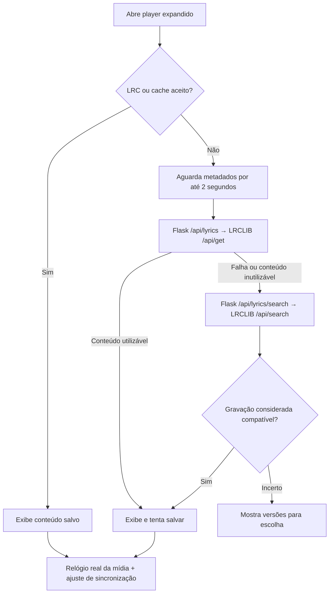

# Auditoria do sistema de letras — BZtune 2.0.9-rc.2

Base examinada: `edba57a091426801dbac48c3595ff2c2defddf03`. A implementação de produção é a do commit `3cb9e02`. Esta auditoria registra testes e pendências; não aplica correções ao programa nem solicita outro instalador.

**Resultado:** os fluxos existentes passaram, incluindo a recuperação automática adicionada na RC2. Foram encontradas **oito pendências principais: duas de prioridade alta e seis de prioridade média**. As mais importantes são a rejeição de respostas de busca com metadados opcionais ausentes e a possibilidade de selecionar automaticamente uma gravação ao vivo como se fosse de estúdio.

Os resultados estruturados estão em [evidencias.json](audits/lyrics-rc2/evidencias.json). Todos os dados musicais usados nos testes adicionais são fictícios; nenhuma biblioteca pessoal foi utilizada.

## 1. Escopo e ambiente

Foram revisados o parser LRC, o cálculo de destaque e seek, a busca exata e alternativa, o backend Flask, o contrato LRCLIB, o cache, a restauração de configurações, os controles, a rolagem, o relógio de mídia e as dependências relevantes.

Ambiente desta rodada: Debian 13 x64, Node 24.19.0, Python 3.12.14 e Chromium 154.0.8037.57. O instalador foi produzido anteriormente pelo GitHub com Node 22 e Windows; esta rodada local não executou o aplicativo Tauri instalado no Windows.

| Verificação | Resultado |
|---|---|
| Build TypeScript/Vite | Aprovado |
| JavaScript do projeto | 77 testes aprovados, incluindo 16 do serviço de letras |
| Python do projeto | 191 testes executados, 2 ignorados, nenhuma falha; 11 testes dos endpoints de letras |
| Navegador: letras, busca automática, relógio e recuperação online | Quatro suítes aprovadas |
| Limites adicionais da API | 15 cenários aprovados |
| Parser: entradas geradas com semente fixa | 2.000 casos aprovados nas invariantes verificadas |
| React → Flask por HTTP real | Consulta exata, fallback, lista de versões e erro de limite de requisições exercitados |
| Respostas gzip por HTTP real | Conteúdo válido aceito e expansão acima de 1 MiB bloqueada |
| Falhas de armazenamento e cache vazio | Defeitos reproduzidos em contextos isolados do Chromium |
| Desempenho | Medições com 100, 1.000 e 3.000 blocos de versos |
| LRCLIB real: `/api/get` e `/api/search` | Bloqueados pelo proxy: `ProxyError` |

Os dois testes Python ignorados exigem, respectivamente, toolchain Rust local e bloqueio real de arquivo pelo Windows. A simulação multiplataforma de bloqueio e os demais testes passaram.

## 2. Como o sistema funciona



O critério atual de cache aceito é estrutural; ele ainda permite conteúdo vazio, conforme o item 4 das pendências.

O áudio local fornece `currentTime`; o YouTube fornece `getCurrentTime()`. O relógio é consultado a cada 100 ms com a letra visível e a página ativa, ou 600 ms nos outros estados. Esses intervalos são solicitações ao navegador, não uma garantia de precisão de voz.

O parser aplica o offset do arquivo, ordena horários e agrupa entradas simultâneas. O ajuste manual desloca o destaque sem alterar o arquivo. O clique no verso faz a operação inversa: horário interpretado mais atraso manual. A rolagem acompanha o bloco ativo até uma interação de leitura manual.

## 3. O que funcionou nos testes

| Área | Comportamentos conferidos |
|---|---|
| Parser | Frações, múltiplos timestamps, offset positivo/negativo, LF/CRLF/CR, texto literal entre colchetes, tradução simultânea e rejeição de importação sem timestamps |
| Relógio | Pausa, buffering, avanço/retorno, A→B→A, identidade da ativação, redução de frequência com a página oculta e mini-player |
| Áudio local | WAV real no navegador, seek, pausa/reprodução, repetição e preservação do tempo da entrada no crossfade |
| Crossfade | Cancelamento iniciado pelo verso, inclusive enquanto `play()` da entrada ainda está pendente; transição posterior continua funcionando |
| Sincronização | Passos de 100 ms, restauração, isolamento entre músicas e fontes, composição com offset LRC e limites no backup |
| Busca | Fallback compatível sem abrir o menu, versões incertas no painel, metadados recebidos durante a requisição, prioridade de importação manual e descarte de resposta antiga |
| Cache/backup normal | Restauração offline, preservação das duas fontes, seleção salva, validação prévia e recuperação de falha na aplicação do backup |
| Interface | Menu por teclado, Esc, foco devolvido ao controle, fechamento fora do menu, três tamanhos de janela, rolagem manual/automática e movimento reduzido |
| API | Título obrigatório, limite de 300 caracteres, duração de 1 a 3.600 segundos, NaN/infinito, UTF-8 no limite de bytes, instrumental, texto vazio, timeout e erro de conexão |

Os 2.000 casos gerados do parser verificaram ausência de exceções, tempos finitos e não negativos, ordenação, agrupamento e preservação de `[echo]`. Isso amplia a cobertura; não prova correção para todo arquivo LRC possível.

## 4. Pendências principais, em ordem de correção

### Item 1 — Metadados opcionais podem derrubar toda a busca de versões (corrigido)

**Status após a auditoria:** corrigido no código. Cada registro é validado isoladamente: registros sem título/artista utilizáveis ou com dados inválidos são descartados sem perder os demais; duração ausente ou `null` permanece `null`. Na interface, essas versões aparecem por último com “Duração indisponível”, podem ser escolhidas e salvas manualmente e ficam fora da seleção automática. Os limites de resposta, quantidade e tamanho das letras continuam ativos. A RC2 já compilada não contém esta correção. As evidências originais abaixo registram o comportamento anterior.

**Validação da correção:** build TypeScript/Vite aprovado; 79 testes JavaScript aprovados (18 do serviço de letras); 192 testes Python executados, com 2 ignorados e nenhuma falha (12 dos endpoints de letras); suítes de navegador `lyrics-auto-lookup`, `lyrics-regression` e `lyrics-clock` aprovadas. Regressões novas cobrem mistura de registros válidos/inválidos, duração ausente/nula, ordenação, bloqueio da seleção automática, escolha manual e restauração do cache em A→B→A. O LRCLIB real continua sem validação ao vivo nesta rodada; respostas externas foram simuladas.

**Prioridade alta.** Referências: [backend](../doomvault-api/api/lyrics_api.py#L51) e [validação do candidato](../doomvault-api/api/lyrics_api.py#L88).

Reprodução: resposta com uma letra válida e outro registro com `duration: null`. O endpoint local devolveu **502**, descartando também a letra válida. O mesmo ocorreu com `artistName: null` em um registro.

O [contrato de referência do LRCLIB](https://github.com/tranxuanthang/lrclib/blob/04369d3f7c6e8cba1790629f26f866547a9b8f88/server/src/routes/search_lyrics.rs#L24) declara duração, título, artista e álbum como opcionais na resposta. O BZtune já trata álbum ausente, mas ainda exige duração numérica e nomes preenchidos em todos os registros. A frequência desses valores na produção não pôde ser medida por causa do bloqueio de rede.

**Impacto:** letras disponíveis podem virar uma mensagem genérica de falha, tanto no fallback automático quanto na escolha manual.

**Correção recomendada:** tratar cada registro isoladamente; manter os válidos, permitir duração desconhecida na escolha manual e reservar a seleção automática para registros com metadados suficientes. Não usar duração zero para representar uma duração desconhecida.

### Item 2 — A identificação de gravação pode confundir estúdio e ao vivo (corrigido)

**Status após a auditoria:** corrigido no fallback de versões. O nome da música é separado das anotações entre parênteses/colchetes ou após separadores; palavras como “Live” no nome não classificam a gravação. As marcações do título e do álbum são comparadas separadamente, impedindo que uma esconda o conflito da outra. “Ao Vivo”, “Acústico/Acústica”, “Unplugged” e “Karaokê” também são reconhecidos. Conflitos continuam disponíveis para escolha manual, sem seleção automática; artista, título e duração compatíveis continuam obrigatórios. A consulta exata ao LRCLIB e letras já salvas não são reclassificadas por esta alteração. As reproduções abaixo descrevem o comportamento anterior.

**Validação da correção:** build TypeScript/Vite aprovado; 81 testes JavaScript aprovados, incluindo 20 do serviço de letras; suítes de navegador `lyrics-auto-lookup` e `lyrics-regression` aprovadas. Foram cobertos os dois casos da auditoria, conflitos entre título e álbum, variantes em português, remaster compatível, seleção manual e cache. Sem nova consulta ao LRCLIB real nem novo instalador nesta rodada.

**Prioridade alta.** Referência: [comparação e seleção](../doomvault/src/services/lyrics.ts#L99).

Duas reproduções confirmadas no serviço real:

| Música solicitada | Candidato recebido | Resultado atual |
|---|---|---|
| `Live Forever`, Oasis, álbum `Definitely Maybe`, 274 s | Mesmo título/artista, álbum `Live at Wembley`, 274 s | Selecionado automaticamente |
| `Canção`, Artista, álbum `Estúdio`, 274 s | Mesmo título/artista, álbum `Ao Vivo`, 274 s | Selecionado automaticamente |

No primeiro caso, a palavra legítima `Live` no título coloca as duas gravações na mesma categoria: o código une palavras do título e do álbum em um conjunto. No segundo, a classificação não reconhece `Ao Vivo`.

**Impacto:** pode carregar e salvar uma letra da gravação errada, com sincronização incorreta, apesar de título, artista e duração próximos.

**Correção recomendada:** distinguir palavras do nome da música de marcações de versão; avaliar título e álbum separadamente, reconhecer variantes em português e pedir escolha quando houver conflito. Proximidade de duração deve continuar sendo um sinal, não confirmação suficiente da gravação.

### Item 3 — A duração que chega depois da busca não retoma a seleção automática

**Prioridade média.** Referências: [início automático](../doomvault/src/player/MusicPlayer.tsx#L350) e [resolução](../doomvault/src/player/MusicPlayer.tsx#L730).

Reprodução no Chromium:

1. O áudio ainda não informa duração durante a espera inicial.
2. A consulta exata falha; a busca de versões termina com um candidato compatível, mas sem duração atual para comparação.
3. A interface mostra a lista.
4. O áudio passa a informar 381 segundos, correspondendo ao candidato.

A lista permaneceu aberta, o cache continuou vazio e a seleção automática não foi reavaliada. O teste existente da RC2 cobre a duração recebida **durante** a requisição; faltava o caso em que ela chega **depois** da conclusão.

**Impacto:** uma inicialização lenta ainda pode exigir intervenção manual, mesmo quando os dados posteriores permitem a comparação.

**Correção recomendada:** reavaliar os candidatos já recebidos quando os metadados forem confirmados, sem nova chamada à API, desde que a faixa e a operação continuem atuais e o usuário não tenha feito uma escolha manual.

### Item 4 — Cache vazio é aceito e impede nova busca

**Prioridade média.** Referências: [validador](../doomvault/src/services/lyrics.ts#L5), [backup](../doomvault/src/services/browser-backup.ts#L25) e [desvio da busca](../doomvault/src/player/MusicPlayer.tsx#L354).

Esta entrada passou pela validação do cache e pela validação do backup:

```json
{"source":"LRCLIB","instrumental":false,"syncedLyrics":"","plainLyrics":""}
```

Com ela no armazenamento, o navegador mostrou `Ainda sem letra por aqui.` e `Letra do LRCLIB · salva neste aparelho.`, sem executar nenhuma consulta exata ou de versões. O fluxo normal de gravação evita salvar esse conteúdo, mas uma restauração ou entrada antiga pode introduzi-lo.

**Impacto:** uma faixa pode ficar sem busca automática indefinidamente, até intervenção no cache ou busca manual.

**Correção recomendada:** validar conteúdo utilizável na leitura e restauração: indicação instrumental, texto não vazio ou timestamps válidos. Tratar cache inutilizável como ausência de cache.

### Item 5 — A recuperação de falha ao salvar não mantém letras por faixa na sessão

**Prioridade média.** Referências: [resultado LRCLIB](../doomvault/src/player/MusicPlayer.tsx#L689), [importação](../doomvault/src/player/MusicPlayer.tsx#L743) e [armazenamento com nova tentativa](../doomvault/src/services/storage.ts).

Falha de cota foi simulada somente nas gravações de letras, em um contexto isolado:

- Um novo LRC válido não pôde ser usado: a importação dependia de `localStorage.setItem` terminar antes de atualizar a interface. A letra anterior foi preservada e houve aviso.
- Uma nova letra LRCLIB apareceu com aviso de disponibilidade apenas na sessão. Ao ir de A para B e voltar a A, ela desapareceu e a letra manual antiga voltou. A nova letra não tinha uma cópia em memória por faixa.

**Impacto:** o programa permanece aberto, mas a letra recém-obtida pode se perder durante a própria sessão. A política difere do ajuste de milissegundos, que usa o serviço de armazenamento com nova tentativa.

**Correção recomendada:** manter letras e seleção em memória por identidade e fonte; persistir separadamente com aviso e nova tentativa. Preservar a letra anterior quando a operação não puder ser concluída continua sendo necessário.

### Item 6 — Limite de requisições do LRCLIB vira erro genérico e provoca outra chamada

**Prioridade média.** Referências: [mapeamento HTTP](../doomvault-api/api/lyrics_api.py#L38) e [fallback](../doomvault/src/services/lyrics.ts#L116).

O upstream simulado devolveu `429` com `Retry-After: 120`. O backend transformou a resposta em **502**, sem `Retry-After`. No teste integrado por HTTP, o frontend fez em sequência uma chamada a `/get` e outra a `/search`; ambas receberam o limite de requisições.

**Impacto:** a interface não distingue indisponibilidade de limitação temporária. A alternativa automática aumenta as chamadas justamente quando o serviço pede espera.

**Correção recomendada:** preservar uma indicação estruturada de limitação e a espera informada; impedir fallback imediato nesse caso. Diferenciar ausência de resultado, timeout, limitação e erro externo, com retomada controlada.

### Item 7 — O prazo e o cancelamento do navegador não encerram o trabalho do backend

**Prioridade média.** Referências: [timeouts do upstream](../doomvault-api/api/lyrics_api.py#L33), [leitura da resposta](../doomvault-api/api/lyrics_api.py#L45), [prazo no cliente](../doomvault/src/services/api-fetch.ts) e [oito threads do servidor](../desktop/backend_entry.py#L80).

No teste HTTP, o cliente desistiu após 100 ms; a requisição do servidor continuou lendo o upstream simulado até cerca de 700 ms e então fechou a resposta. O comportamento é distinto da proteção da interface, que corretamente ignora respostas antigas.

`requests` utiliza timeout de conexão e de inatividade de leitura, sem um prazo global explícito para concluir toda a transferência. O limite de bytes não impõe um limite de duração. No frontend, consulta exata e alternativa têm prazos separados de 20 segundos: o fluxo pode consumir aproximadamente 40 segundos, além da espera inicial.

**Impacto:** consultas lentas e trocas rápidas de faixa podem manter trabalho obsoleto ocupando o serviço local. O backend Desktop tem oito threads compartilhadas com outras operações. **Não foi realizado um teste esgotando essas oito threads**; esse efeito de saturação é um risco derivado do comportamento reproduzido e da configuração.

**Correção recomendada:** estabelecer prazo global por operação e mecanismo de interrupção/limitação de trabalho externo; controlar concorrência e reutilizar resultados quando apropriado. O cancelamento precisa existir no serviço, além de impedir a atualização da interface.

### Item 8 — O limite do arquivo não limita a expansão nem o custo de renderização

**Prioridade média.** Referências: [expansão dos timestamps](../doomvault/src/services/lyrics.ts#L19), [renderização dos versos](../doomvault/src/player/MusicPlayer.tsx#L954) e [atualização do relógio](../doomvault/src/player/MusicPlayer.tsx#L569).

Um LRC de **167.000 bytes**, abaixo do limite de 250 KB, com 1.000 timestamps iniciais e um verso de 160.000 caracteres produziu 1.000 entradas. O conteúdo total a apresentar seria de **160 milhões de caracteres**. Essa é a expansão lógica do conteúdo; não é uma medição de 160 MB de memória. Esse caso extremo foi analisado no parser e não foi renderizado no navegador.

Também foram importados arquivos menores e controlados no Chromium, com relógio simulado em movimento:

| Blocos | Arquivo | Importação observada | Tempo ocupado por tarefas / janela observada | Heap JS |
|---:|---:|---:|---:|---:|
| 100 | 3.989 bytes | 77 ms | 101,38 / 1.203,63 ms — 8,4% | 12,13 MiB |
| 1.000 | 40.889 bytes | 95 ms | 386,79 / 1.201,83 ms — 32,2% | 20,32 MiB |
| 3.000 | 124.889 bytes | 276 ms | 696,95 / 1.209,76 ms — 57,6% | 61,33 MiB |

São medições indicativas de uma rodada neste ambiente, sem garantia de desempenho em outro computador. Não houve exceção de página nesses três arquivos. O custo cresceu porque todos os versos são renderizados e reconciliados dentro do componente do player, atualizado pelo relógio.

**Impacto:** arquivos permitidos podem consumir muito processamento e gerar uma interface pouco responsiva; a expansão extrema merece proteção antes de chegar ao DOM.

**Correção recomendada:** limitar a expansão interpretada e o volume total de texto, além do tamanho do arquivo; isolar/memoizar o leitor e avaliar renderização somente dos versos visíveis. Informar limites sem substituir a letra anterior por um resultado que a interface não possa apresentar.

## 5. Backend, APIs e proteção do conteúdo

- O destino externo é fixo e HTTPS; parâmetros não escolhem outro host. Redirecionamentos não são seguidos.
- O limite de 1 MiB é aplicado aos bytes descomprimidos antes de interpretar JSON. Em HTTP real, 100.000 caracteres comprimidos em 158 bytes foram aceitos; uma resposta comprimida de 1.093 bytes que expandia acima do limite recebeu 502. Nesse segundo caso, a letra tinha apenas cinco caracteres e o excesso estava em outro campo JSON, distinguindo o limite da resposta do limite por campo de letra.
- O limite de 250 KB por campo foi conferido com caracteres UTF-8 de dois bytes, inclusive exatamente no limite e logo acima.
- As origens Tauri e Vite permitidas receberam 200; origem externa, origem `null` e domínio com sufixo enganoso receberam 403. O preflight Tauri autorizado recebeu as permissões CORS e PNA esperadas.
- Observação de baixa prioridade: para `http://127.0.0.1.evil.invalid`, o Flask-CORS emitiu um cabeçalho de permissão, mas a guarda de origem devolveu 403 e não entregou a letra. A expressão regular CORS merece ancoragem para ficar coerente com a guarda; o teste não demonstrou leitura de letras por essa origem.
- O texto `<script>window.auditPwn=true</script>` foi exibido literalmente pelo React e não executou. Acentos e travessão foram preservados no teste HTTP integrado.
- Os eventos da integração mostraram apenas título, artista, álbum e duração na consulta exata; a busca de versões usou título e artista. Não foram enviados arquivos de áudio, caminhos da biblioteca ou credenciais ao upstream simulado.

## 6. Dependências

| Camada | Versões verificadas | Avaliação |
|---|---|---|
| Backend de letras | Flask 3.1.3, Flask-Cors 6.0.5, requests 2.34.2, urllib3 2.8.0, certifi 2026.10.19 | `pip check` sem incompatibilidades no ambiente local |
| Lock Python do instalador | 27 pacotes fixados | `pip-audit` 2.10.1: nenhuma vulnerabilidade conhecida retornada pela base consultada |
| Interface | React/React DOM 18.3.1, lucide-react 0.468.0 | Build e testes aprovados; sem dependência específica adicional para ler LRC |
| Ferramentas do frontend | TypeScript 5.6.3, Vite 6.4.4 | `npm audit` do lock: zero vulnerabilidades conhecidas, incluindo desenvolvimento |
| CLI Desktop | @tauri-apps/cli 2.12.3 | Instalação limpa por `npm ci` concluída; `tauri info` executado; `npm audit` do lock com zero vulnerabilidades conhecidas |
| Rust no lock | Tauri 2.12.4; updater 2.14.0; dialog 2.8.3; shell 2.5.0 | Versões inspecionadas; consulta OSV das 490 entradas de registro bloqueada pelo proxy |

O CLI Desktop ainda não estava instalado neste workspace; foi instalado pelo lock existente, sem alterar versões do projeto. Os avisos sobre ausência de pacotes JavaScript dos plugins não indicam, por si, uma falha: a aplicação utiliza comandos Rust e a API global do Tauri.

Não há Rust/Cargo nem os pré-requisitos de WebKit GTK neste ambiente. Portanto, não foi repetida uma compilação nativa local. Há uma [compilação Windows anterior aprovada da própria RC2](https://github.com/BadZ7br/BZtune/actions/runs/39695473476), incluindo testes, empacotamento e validação da assinatura Tauri; isso é evidência anterior, distinta dos testes desta auditoria.

O lock Python fixa versões, mas não hashes de distribuição. Isso permite auditoria de versões e reduz variações, porém não equivale à verificação de integridade por hash de todos os pacotes. A ausência de advisories encontrados também não é garantia de ausência de vulnerabilidades. Não há resultado conclusivo de advisories Rust nesta rodada.

## 7. Limitações e observações de manutenção

- O LRCLIB real não pôde ser consultado. O contrato foi comparado com o código público do servidor no commit `04369d3f7c6e8cba1790629f26f866547a9b8f88`; não foi medida a disponibilidade atual nem a proporção de letras com metadados ausentes.
- O YouTube foi simulado. O WAV local foi reproduzido pelo navegador, mas não se mediu alinhamento perceptivo com voz real, atraso Bluetooth ou placa de som.
- As regressões no Windows da CI usam Chromium; não automatizam a instalação e a interação do usuário dentro do WebView2. Android físico e versões antigas de WebView não foram testados.
- O transporte depende do sidecar Desktop em `127.0.0.1:5000`. A futura migração Android precisará de um adaptador de transporte e armazenamento.
- Não há sincronização por palavra. Um Enhanced LRC com marcações `<00:01.500>` foi tratado como texto literal. Isso é uma limitação de formato, não prova de falha no sincronismo por verso implementado.
- A importação usa `File.text()`, sem escolha de codificação. Arquivos em codificações antigas não têm garantia de preservar acentos; a rodada validou UTF-8.
- O cache não tem política de expiração/evicção e usa o identificador da música; mudanças de metadados ou gravações sob o mesmo identificador merecem estratégia explícita de invalidação. A resposta exata também não conserva os metadados retornados pelo provedor, ao contrário de candidatos da busca de versões.

## 8. Roteiro de verificação

Com as dependências instaladas e um ambiente Python adequado:

```sh
node --test tests/*.test.mjs
python -m unittest discover -s tests -v
npm --prefix doomvault run build
npm --prefix doomvault run dev -- --host 127.0.0.1 --port 5173 --strictPort
```

Em outro terminal, com Chromium/Playwright disponíveis:

```sh
CHROMIUM_PATH=/usr/bin/chromium node tests/browser/lyrics-regression.cjs
CHROMIUM_PATH=/usr/bin/chromium node tests/browser/lyrics-auto-lookup.cjs
CHROMIUM_PATH=/usr/bin/chromium node tests/browser/lyrics-clock.cjs
CHROMIUM_PATH=/usr/bin/chromium node tests/browser/online-player-recovery.cjs
npm --prefix doomvault audit --json
npm --prefix desktop audit --json
pip-audit --no-deps --disable-pip -r desktop/requirements-windows.lock
```

As reproduções adicionais são descritas nos itens e registradas em [evidencias.json](audits/lyrics-rc2/evidencias.json): `backend`, `pure`, `browser_edge_cases`, `real_http_frontend_flask`, `gzip`, `performance`, `api_boundaries` e `parser_generated_cases`. Os servidores de teste usaram diretórios temporários e portas locais isoladas; foram encerrados ao terminar.

**Sequência recomendada:** corrigir primeiro os itens 1 e 2; depois os itens 3 e 4 para completar a recuperação automática; em seguida armazenamento, tratamento de limites da API, prazo do backend e renderização de arquivos extensos. Cada correção deve acrescentar uma regressão para a reprodução correspondente sem remover os cenários já aprovados.
